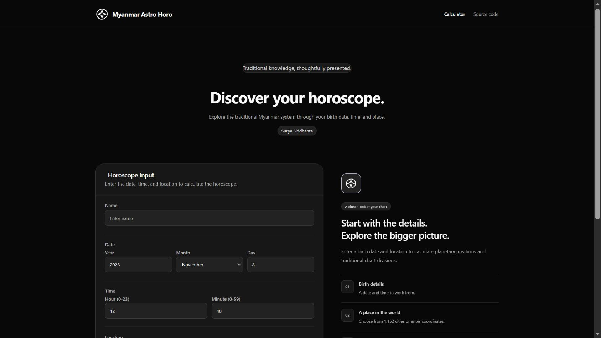

# Myanmar Astro Horo (မြန်မာဇာတာတွက်စက်)

မွေးနေ့၊ မွေးချိန်နဲ့ မွေးရာနေရာကို ထည့်ပြီး ရိုးရာဇာတာ၊ ရာသီ၊ နဝင်း၊ ဒြေက္ကာဏ၊ ဒသာ၊ ဘာဝနဲ့ မြန်မာပြက္ခဒိန်ဆိုင်ရာ ရလဒ်တွေကို ကြည့်နိုင်တဲ့ **.NET 10 Blazor WebAssembly Project** ပါ။

[Burma Project Ideas](https://github.com/burma-project-ideas) အောက်မှာ နောက်လာမယ့်သူတွေ Calculation Flow ကို လေ့လာပြီး ကိုယ်နှစ်သက်တဲ့ Language နဲ့ ပြန်ရေးကြည့်နိုင်ဖို့ ထားပေးထားတာပါ။ [Live App ကို ဒီမှာ ဖွင့်နိုင်ပါတယ်](https://myanmar-astro-horo.vercel.app/)။

## အဓိက ပံ့ပိုးသူများနှင့် မူရင်း Data

- Blazor implementation: [Sann Lynn Htun](https://github.com/sannlynnhtun-coding)။
- မူရင်း VB6 Reference: [fossmyanmar/myanmar_astro_horo](https://github.com/fossmyanmar/myanmar_astro_horo)။ `docs/MIGRATION_CHECKLIST.md` က `CleanVB6/MAH_SS-FOSS.vbp` နဲ့ မူရင်း Module တွေကို ရည်ညွှန်းထားပါတယ်။ မူရင်း Contributor တစ်ဦးချင်းကို ဒီ Repository မှာ မသတ်မှတ်ထားတဲ့အတွက် Upstream Project ကို Credit ပေးထားပါတယ်။
- City Directory က Legacy Data Records ၁,၁၅၂ ခုကို `wwwroot/data/legacy-cities.json` မှာ ထိန်းသိမ်းထားပါတယ်။
- Organization ဆီ ရွှေ့ထားခြင်းက မူရင်း Calculation၊ Data နဲ့ Contributor Credit ကို မပြောင်းလဲပါဘူး။

## အသုံးပြုပုံ

1. Home မှာ မွေးရက်၊ အချိန်နဲ့ နေရာကို ထည့်ပါ။ City Directory ထဲက နေရာကို ရွေးနိုင်ပါတယ်။
2. Standard Time သို့မဟုတ် Local Mean Time ကို သတ်မှတ်ပြီး တွက်ချက်ပါ။
3. Summary၊ Planet Positions၊ Rasi/Navamsa/Drekkana Charts၊ Dasa၊ Bhava နဲ့ BO Calendar ကို ကြည့်ပါ။
4. Browser ထဲမှာ Horoscope Record သိမ်းခြင်း၊ ပြန်ဖွင့်ခြင်းနဲ့ ဖျက်ခြင်းကို အသုံးပြုနိုင်ပါတယ်။
5. Print မှတစ်ဆင့် Browser ရဲ့ Save as PDF ကို အသုံးပြုနိုင်ပါတယ်။

## App ရဲ့ Workflow

1. `Home.razor` က Input နဲ့ City Selection ကို လက်ခံပါတယ်။
2. `AstroDataService.CalculateAstroAsync` က Date နဲ့ Longitude ကို စစ်ပြီး `SuryaSiddhantaCalculator` ဆီ ပေးပါတယ်။
3. Calculator က Julian Day၊ Planet Positions၊ Lagna နဲ့ ဆက်စပ်တန်ဖိုးတွေကို တွက်ပါတယ်။
4. `MyanmarCalendarCalculator`၊ `DasaCalculator` နဲ့ `BoCalculator` က Calendar၊ Period နဲ့ BO Table တွေကို တည်ဆောက်ပါတယ်။
5. `AstroResultModel` ထဲက Results ကို Page Components တွေက ဖော်ပြပါတယ်။ `SavedHoroscopeService` က Browser-local Record တွေကို ကိုင်တွယ်ပါတယ်။

## Project ဖွဲ့စည်းပုံ

| Path | တာဝန် |
| --- | --- |
| `BlazorMyanmarAstroHoro/Pages/` | Input၊ Charts၊ Dasa၊ Bhava၊ BO နဲ့ Guidance Pages |
| `BlazorMyanmarAstroHoro/Services/` | Calculation၊ City Directory နဲ့ Saved Records |
| `BlazorMyanmarAstroHoro/wwwroot/data/legacy-cities.json` | Legacy City Data |
| `docs/MIGRATION_CHECKLIST.md` | VB6 Migration Progress နဲ့ မပြီးသေးတဲ့ Verification |

## Local မှာ Run မယ်

.NET 10 SDK လိုပါတယ်။

```sh
git clone https://github.com/burma-project-ideas/myanmar-astro-horo.git
cd myanmar-astro-horo
dotnet restore BlazorMyanmarAstroHoro.slnx
dotnet run --project BlazorMyanmarAstroHoro/BlazorMyanmarAstroHoro.csproj
```

Terminal က ပြတဲ့ Local URL ကို ဖွင့်ပါ။

## Build နဲ့ Deployment

```sh
dotnet build BlazorMyanmarAstroHoro.slnx -c Release
dotnet publish BlazorMyanmarAstroHoro/BlazorMyanmarAstroHoro.csproj -c Release -o artifacts/publish
```

`artifacts/publish/wwwroot` ကို Static Host မှာ Serve လုပ်ပြီး Client-side Routes အတွက် `index.html` Fallback သတ်မှတ်ပါ။ Production ကို Vercel မှာ Deploy လုပ်ထားပြီး [Live App](https://myanmar-astro-horo.vercel.app/) ကို အသုံးပြုနိုင်ပါတယ်။ .NET Publish ပြီးသား Static Files ကို Vercel Build Output API Format နဲ့ `vercel deploy --prebuilt --prod` သုံးကာ Deploy လုပ်ထားတာပါ။ Published File တွေကို အရင် Serve ပြီး Client-side Routes အတွက် `index.html` Fallback သုံးပါတယ်။ လက်ရှိ Deployment က Manual CLI Deployment ဖြစ်ပြီး Git Push ကနေ Auto-deploy မသတ်မှတ်ထားသေးပါဘူး။

## စစ်ဆေးမယ်

Build ပြီး Input Validation၊ City Directory၊ Calculation၊ Save/Open/Delete နဲ့ Print ကို စမ်းပါ။ VB6 Golden Test Comparison၊ Exact Calendar Presentation၊ Seconds/Gender Fields နဲ့ Responsive Verification တွေ ကျန်ရှိကြောင်း `docs/MIGRATION_CHECKLIST.md` မှာ ဖော်ပြထားပါတယ်။ Migration Checklist က ပြီးစီးမှုကို သင်္ချာမှန်ကန်မှုအာမခံချက်အဖြစ် မယူသင့်ပါဘူး။

## ကိုယ်တိုင် ပြန်ရေးကြည့်ချင်ရင်

Input → Time/Location Normalization → Calculation → Result Model → Charts ဆိုတဲ့ Flow ကို ခွဲလေ့လာပါ။ မူရင်း VB6 နဲ့ တူညီတဲ့ Inputs အတွက် Output Comparison Tests ထည့်ပြီးမှ Calculation ပြောင်းလဲပါ။ Upstream Credit ကို ဆက်လက်ထိန်းသိမ်းပြီး Bug Report နဲ့ Documentation ကို Issue / Pull Request နဲ့ ပံ့ပိုးနိုင်ပါတယ်။

## UI Design Update

The interface follows [Bencho](https://bencho.dev/)'s dark visual direction: a black canvas, charcoal panels, white pill actions, compact headings, and restrained interaction feedback. The app stays in Blazor with native controls and a locally compiled Tailwind CSS stylesheet. No React component package, Bootstrap, Radzen, Font Awesome, or runtime Tailwind CDN is required.

Application data and calculation/storage behavior are preserved. The Myanmar Padauk font and its license remain included. Keyboard focus, responsive reflow, and reduced-motion preferences are supported.

After changing styles or utility classes, run `npm ci` and `npm run build:css` before the .NET publish command. Generated CSS is committed so existing static deployment workflows remain compatible.



[Mobile preview](screenshots/redesign-mobile.jpg)

## Brand assets

The original monochrome mark matches the dark interface. Transparent SVG/PNG masters, a dark-on-light variant, favicon sizes (16/32/48), Apple touch icon (180), app icons (192/512), and a 1200×630 social image are generated from `wwwroot/branding/logo-master.svg`. Run `npm ci && npm run build:brand` to regenerate them. Existing font and data licenses remain unchanged.
